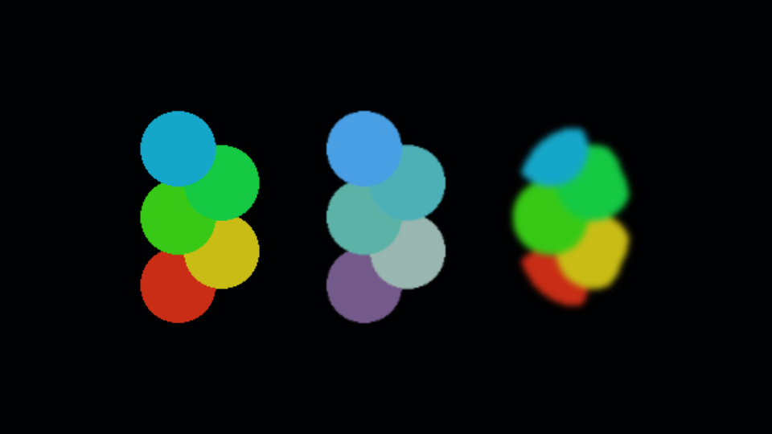

# Scene Layer Visual

Per-group blur and color grading for **orthographic Unity URP scenery**. By [marmunc](https://github.com/marmunc), under the [MIT license](LICENSE).

Add one component to a scenery container to process its children together, after lighting, without modifying source textures or materials. Preview in Scene View (2D) and Game View.



## Features

- Gaussian blur, 0–256 viewing-camera pixels.
- Exposure, tint, saturation and contrast.
- Full, Half and Quarter capture resolution; extra downsampling for wide blur.
- Independent settings for sibling scenery groups.
- SpriteMask-aware capture, including masks outside the container.
- UI and standalone 2D light volumes stay outside the layer capture; source sprites keep their normal illumination.
- Neutral defaults bypass processing; disabling the component releases its resources.
- Multi-object Inspector, Undo and a bulk-add command for direct children.

## Requirements and compatibility

Initial target: **Unity 6000.2.7f2**, **URP 17.2.0**, **Linear color space**, orthographic cameras. Dependencies: URP and Unity 2D Sprite (used for sprite importing). No additional gameplay or Editor-automation packages are required.

The public namespace is `SceneLayerVisuals`. The runtime and editor assemblies are `SceneLayerVisual.Runtime.asmdef` and `SceneLayerVisual.Editor.asmdef`. The processing shader is `Runtime/Resources/SceneLayerVisual.shader`.

Version 0.1 targets SpriteRenderer scenery in URP 2D Renderer. Universal Renderer is also covered by the rendering checks. Other Unity/URP versions, platforms and custom materials need independent verification; see [validation](Documentation~/validation.md) for actual results and remaining checks.

Perspective and stereo cameras, overlay cameras and base cameras with a non-empty camera stack bypass the effects. Nested effect groups are outside v0.1 support. Use sibling groups.

## Install

Open **Window → Package Manager → + → Install package from git URL** and paste:

```text
https://github.com/marmunc/SceneLayerVisual.git#v0.1.2
```

Alternatively, download `SceneLayerVisual-0.1.2.zip` from the [0.1.2 release](https://github.com/marmunc/SceneLayerVisual/releases/tag/v0.1.2), extract it, choose **Install package from disk**, and select `package.json`.

Unity's [Git package instructions](https://docs.unity3d.com/6000.2/Documentation/Manual/upm-ui-giturl.html) explain Git prerequisites. The package follows Unity's [UPM layout](https://docs.unity3d.com/6000.2/Documentation/Manual/cus-layout.html).

## Quick start

1. Use an orthographic camera with URP; set Scene View to 2D for preview.
2. Put scenery under an empty container. Keep the group contiguous in the scene's sorting order.
3. Add a **SortingGroup** to the container and choose its sorting layer/order.
4. Add **Scene Layer Visual → Scene Layer Visual** to the container.
5. Adjust Blur or Color. Start with Half resolution.
6. Disable the component using its header checkbox to compare with the source rendering and release its resources. **Reset Effects** returns to neutral color/blur values and preserves the quality setting.

For multiple containers, select their parent and use **GameObject → Scene Layer Visual → Add Visual Controls To Scene Layers**. This adds controls to direct children only. The command also supports prefab assets; back up a prefab before editing its shared asset.

## Demo

Import **Basic Demo** from the package's Samples tab and open `BasicDemo.unity`. It contains original, graded and blurred sprite groups plus a SpriteMask and Global 2D Light. Set the demo camera to your project's 2D Renderer if its renderer index differs. The included pipeline assets are for an isolated demonstration; do not replace a game's render settings just to use the component.

## Sorting and masks

The whole group becomes **one transparent composite** at its SortingGroup position. Its children cannot interleave with objects outside that group. Without a SortingGroup, the first collected renderer supplies the composite sorting layer and order.

Source SpriteMask clipping is applied **before** blur. Blur can spread the already-clipped image beyond a mask edge. This is not a mask for the final effect. Masks retain Unity's SortingGroup, custom-range and camera-culling rules.

Disabled/inactive renderers are excluded, and existing `forceRenderingOff` values are preserved. A child with its own SceneLayerVisual belongs to that child component; avoid nesting, including disabled nested components. Supported source materials should produce normal transparent sprite output; additive and unusual blend modes are not guaranteed after compositing.

## Cost

Each visible, non-neutral group needs another camera render. Color grading adds one image pass when its values are non-neutral; blur adds two. The capture and result textures are reused for all image passes, with no third full-size blur buffer. Gaussian weights are normalized once when the sample count changes.

The implementation scans active scene Renderers, Canvas and Light2D components once per viewing camera only when an effect group is visible. Outside artwork, UI and standalone light volumes are hidden/restored once for the batch; between captures only the current group's sources change visibility. Canvas enable changes can also trigger UI rebuilds. Full resolution and many groups still cost more CPU, GPU time and memory.

Above 24 pixels of blur, capture resolution automatically drops, up to 8x per dimension. Above that limit the shader increases sample density. Wide blur can therefore cost more even after downsampling. Neutral settings bypass processing and keep existing buffers for reuse; disabling/removing the component releases them.

See [architecture](Documentation~/architecture.md) and [validation](Documentation~/validation.md).

## License

MIT; see [LICENSE](LICENSE). The package and its generated demo artwork are by marmunc. Unity and URP are separate products under their own terms. The MIT text is available from the [Open Source Initiative](https://opensource.org/license/mit).
